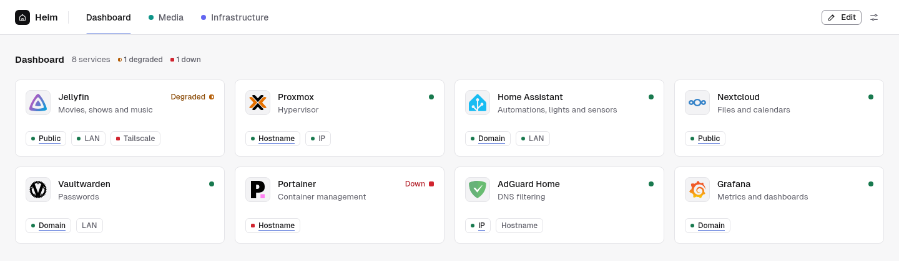
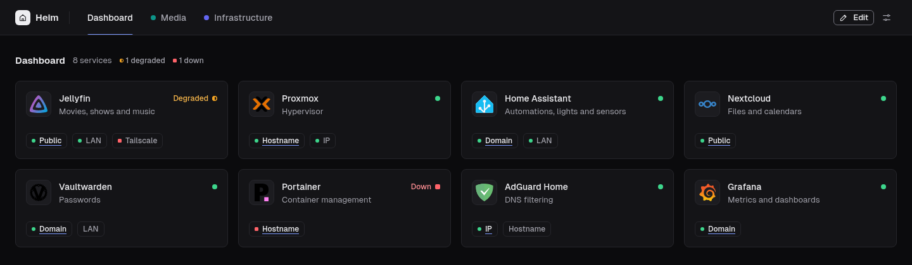

# Heim

A clean, minimal start page for your self-hosted apps, built around **services** rather than URLs.

Dashboards like [Heimdall](https://github.com/linuxserver/Heimdall) give every tile exactly one link. But you usually reach the same app several ways: a public domain, a LAN hostname, a bare IP, a VPN address. In Heim one tile is one service, and it carries all of those links, each with its own health check.





## Features

- **Multiple links per service.** Each link has a label and a kind (public, domain, hostname, IP, VPN, other). Clicking the card opens the primary link, and the other links sit right below it.
- **Health checks per link.** Optional HTTP probes run on the server, with configurable status codes, timeouts, a custom probe URL and an option to ignore TLS errors. Status updates appear live, and a card shows *degraded* when only some of its links are up.
- **Tabs.** Group services into tabs such as *Media* or *Infrastructure*, and put a service on as many tabs as you like. Each tab has its own order, and a "show all" tab lists everything.
- **Icons without the hassle.** Heim fetches the site's favicon automatically, or you can pick from the [dashboard-icons](https://github.com/homarr-labs/dashboard-icons) library, paste an image URL, or upload your own. Icons are cached locally.
- **Your look.** Light, dark or system theme, a background image, and custom CSS.
- **Optional login.** Choose whether a login is needed to view the dashboard, to edit it, or both.
- **Backup.** Export and import everything (config, icons, uploads) as a single zip.
- **Simple to run.** One container on one port, configured entirely from the web UI. Everything is stored in a single `config.json`, with no database.

## Quick start

With Docker Compose:

```yaml
services:
  heim:
    build: .
    container_name: heim
    restart: unless-stopped
    ports:
      - "8000:8000"
    volumes:
      - ./data:/data
```

```sh
git clone https://github.com/soynx/Heim.git heim
cd heim
docker compose up -d --build
```

Open **http://localhost:8000**, add your first service, and you're done. All settings are made in the web UI.

### Configuration

Everything (config, cached icons, uploads) lives in `/data`. These environment variables are optional:

| Variable | Default | Meaning |
|---|---|---|
| `PUID` / `PGID` | `1000` | User and group Heim runs as. At startup `/data` is made owned by them, so a `./data` folder that Docker creates as root works out of the box. |
| `HEIM_SECURE_COOKIES` | `false` | Set to `true` when Heim is only reached over HTTPS, so cookies are marked `Secure`. |
| `HEIM_RESET_AUTH` | `false` | Locked out? Set to `true` for one start to clear the login credentials and turn the login off. |

**Behind a reverse proxy:** Heim uses the `X-Forwarded-*` headers your proxy sends. Make sure the proxy sets them, and that Heim can't be reached around the proxy.

## Building from source

Requires Java 21 and Maven.

```sh
mvn package
HEIM_DATA_DIR=./data java -jar target/heim.jar
```

`mvn test` runs the test suite. The REST API is documented at `/api/docs` (OpenAPI) on a running instance.

## Tech

Java 21 and Spring Boot on the backend. The frontend is plain HTML, CSS and JavaScript, with no build step and self-hosted fonts, so it works offline.

## License

[MIT](LICENSE)
